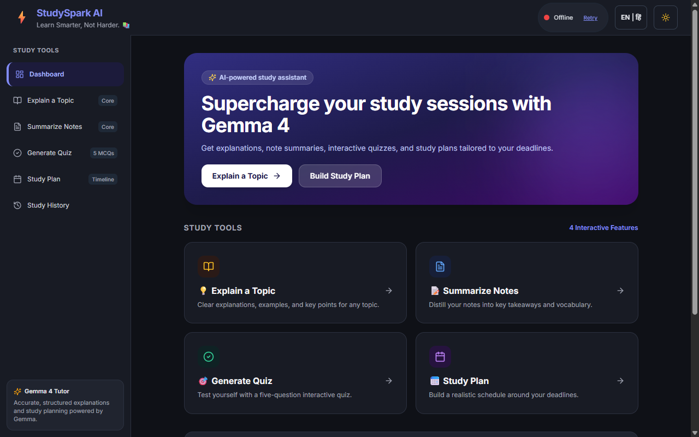
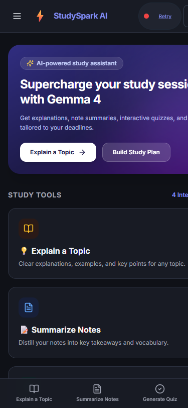

no# StudySpark AI

> **Learn Smarter, Not Harder.**

StudySpark AI is an AI-powered study companion for turning a topic or class notes into useful study materials. It combines a Vite + React frontend with a FastAPI backend and Gemma 4 through the Gemini API.

## Features

- **Explain a Topic** — clear explanations at beginner, intermediate, or advanced level.
- **Summarize Notes** — concise summaries, key points, and key terms based on your notes.
- **Generate Quiz** — five multiple-choice questions with answer explanations.
- **Generate Study Plan** — a day-by-day plan based on subjects, available study time, and deadlines.
- **Study History** — revisit saved results in your browser.

The interface supports English and Hindi AI responses, light and dark themes, and mock mode for trying the frontend without an API key.

## Screenshots

| Desktop Dashboard | Mobile View |
|---|---|
|  |  |

## Tech stack

- Frontend: React 18, Vite, Tailwind CSS, React Router, and lucide-react
- Backend: FastAPI, Pydantic v2, slowapi
- AI: Gemma 4 via Google's `google-genai` SDK
- Browser storage: `localStorage`; no account or application database

## Architecture

```text
┌─────────────────────────────────────┐
│ Browser: Vite + React               │
│ UI, language/theme, local history   │
└──────────────────┬──────────────────┘
                   │ HTTPS/JSON
                   ▼
┌─────────────────────────────────────┐
│ FastAPI backend                     │
│ validation, rate limit, CORS,        │
│ provider error handling              │
└──────────────────┬──────────────────┘
                   │ backend-only key
                   ▼
┌─────────────────────────────────────┐
│ Gemini API: configured Gemma model  │
└─────────────────────────────────────┘
```

## Run locally (Windows PowerShell)

Use two PowerShell terminals from the repository root.

### 1. Start the backend

```powershell
cd backend
python -m venv .venv
.\.venv\Scripts\Activate.ps1
pip install -r requirements.txt
Copy-Item .env.example .env
```

Set `GEMINI_API_KEY` in `backend\.env`, then start the API:

```powershell
uvicorn main:app --reload --port 8000
```

The health endpoint is available at [http://localhost:8000/api/health](http://localhost:8000/api/health); interactive API docs are at [http://localhost:8000/docs](http://localhost:8000/docs).

### 2. Start the frontend

In the second terminal:

```powershell
cd frontend
npm install
Copy-Item .env.example .env
npm run dev
```

Open [http://localhost:5173](http://localhost:5173).

The checked-in frontend environment template sets `VITE_USE_MOCKS=true`, so the UI uses sample responses without calling the backend. To use live AI responses, change it to `VITE_USE_MOCKS=false` in `frontend\.env` and set a valid `GEMINI_API_KEY` in `backend\.env`. Restart the Vite server after changing frontend environment variables.

## Environment variables

### Backend (`backend/.env`)

| Variable | Default | Description |
|---|---|---|
| `GEMINI_API_KEY` | *(empty)* | Gemini API key; required for live model responses. |
| `GEMMA_MODEL` | `gemma-4-26b-a4b-it` | Gemma model ID. |
| `INFERENCE_PROVIDER` | `gemini_api` | Inference provider. |
| `ALLOWED_ORIGINS` | `http://localhost:5173` | Comma-separated frontend origins allowed by CORS. |
| `RATE_LIMIT` | `20/minute` | Per-client request limit. |
| `MODEL_TIMEOUT_SECONDS` | `30` | Backend model-call timeout. |
| `LOG_LEVEL` | `INFO` | Backend logging level. |
| `APP_ENV` | `development` | Use `production` on the deployed backend to disable interactive API docs and enforce production CORS settings. |

### Frontend (`frontend/.env`)

| Variable | Default | Description |
|---|---|---|
| `VITE_API_BASE_URL` | `http://localhost:8000` | Backend base URL. |
| `VITE_USE_MOCKS` | `true` | Set to `false` to send requests to the backend. |

**Keep `GEMINI_API_KEY` only in `backend/.env`.** Never put it in a `VITE_*` variable or frontend source; Vite variables are exposed to the browser. Do not commit `.env` files. Use the `.env.example` templates instead.


## Deployment preparation

The project is prepared for separate frontend and backend hosting; it has not been deployed.

### Backend

- Use `backend` as the service root and install with `pip install -r requirements.txt`.
- Start from that directory with `uvicorn main:app --host 0.0.0.0 --port $PORT` (use the host's assigned port).
- Configure `APP_ENV=production`, `GEMINI_API_KEY`, `GEMMA_MODEL`, and `ALLOWED_ORIGINS` in the host's secret/environment settings. Set `ALLOWED_ORIGINS` to the exact deployed frontend origin, including its scheme and without a path. Production rejects wildcard and localhost origins.
- `GET /api/health` is the health-check path. A successful response and `ai_configured: true` confirm the API is responding and a non-empty key is configured; they do **not** prove the provider accepts the key or that inference succeeds.
- Keep debug off and do not expose the API key through frontend configuration or logs.

### Frontend

- Use `frontend` as the service root, run `npm run build`, and publish `dist`.
- Set the public build variable `VITE_API_BASE_URL` to the backend URL (no trailing slash). Set `VITE_USE_MOCKS=false`; mock fixtures are also disabled in production builds even if this variable is accidentally set to `true`.
- The existing [frontend/vercel.json](./frontend/vercel.json) provides the SPA rewrite needed for client-side routes.

### Release verification and troubleshooting

1. Deploy neither service until hosting and publication are explicitly approved.
2. After backend configuration, check `/api/health`, then make one manual feature request in English and Hindi. Real requests consume provider quota; automated tests use deterministic mocks.
3. Configure the backend CORS allowlist with the exact deployed frontend origin and confirm the frontend can call the health endpoint.
4. Run all four feature flows against the deployed URL on desktop and a phone. A health check only tests backend availability, not real model inference.
5. If the UI reports the backend offline on local development, use `http://localhost:5173` and `http://localhost:8000` consistently, or add the exact alternate origin (such as `http://127.0.0.1:5173`) to development CORS settings.
6. For `MODEL_UNAVAILABLE`, `MODEL_TIMEOUT`, or `MODEL_OUTPUT_INVALID`, check the configured model ID, provider status, key validity, quota, and backend logs. The API returns safe error envelopes and does not substitute mock output for failed live requests.

## Tests and checks

Run backend tests from the `backend` directory:

```powershell
python -m pytest
```

With the backend virtual environment activated, you can also check live English and Hindi model access (requires a valid key):

```powershell
python smoke_test.py
```

Build the frontend from the `frontend` directory:

```powershell
npm run build
npm test
```

## API overview

| Method | Endpoint | Purpose |
|---|---|---|
| `GET` | `/api/health` | Backend and model configuration status |
| `POST` | `/api/explain` | Explain a topic |
| `POST` | `/api/summarize` | Summarize notes |
| `POST` | `/api/quiz` | Generate a quiz |
| `POST` | `/api/study-plan` | Generate a study plan |

AI endpoints return a consistent success or error envelope. The backend validates model output before returning it to the frontend.

## Project layout

```text
StudySparkAI/
├── backend/
│   ├── main.py                 # FastAPI app and API routes
│   ├── config.py               # Environment settings
│   ├── schemas.py              # Request and response models
│   ├── prompts.py              # Prompts for the four study tools
│   ├── gemma_service.py        # Model calls, parsing, validation, and retry
│   ├── tests/                  # Backend test suite
│   └── .env.example            # Backend environment template
├── frontend/
│   ├── src/
│   │   ├── components/         # Feature panels and shared UI
│   │   ├── context/            # Theme and language settings
│   │   ├── hooks/              # Browser storage and history
│   │   ├── pages/              # Home and study history
│   │   └── services/           # Backend API client and mock fixtures
│   ├── .env.example            # Frontend environment template
│   └── package.json
└── docs/spec/                  # Product, API, design, and test specifications
```

## Notes

- AI-generated study materials can be inaccurate; verify important facts.
- Avoid entering personal or sensitive information. In live mode, submitted study content is sent to the configured model API.
- Study history and settings are stored in the current browser's `localStorage`.
