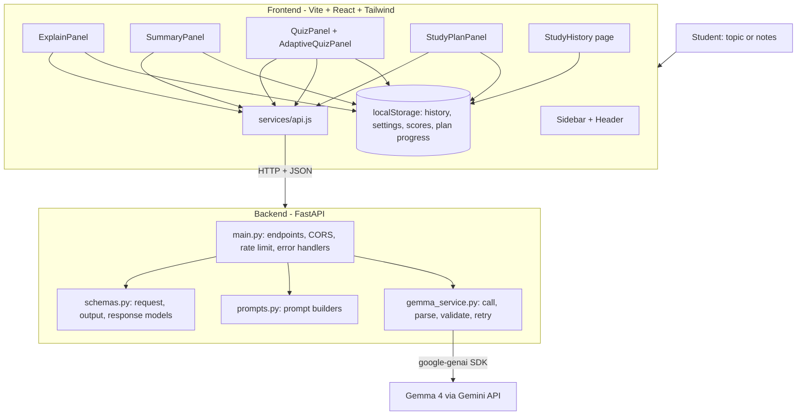

# System Design — StudySpark AI

---

## 1. Architecture



One frontend, one backend, one model integration, and four core features plus a separate opt-in Adaptive Quiz. Results render inline in each panel; History reopens saved results and completed adaptive summaries.

## 2. Component responsibilities

| Component | Responsibility |
|---|---|
| `Sidebar.jsx` | Navigation between the four tools and History; bottom tab bar on mobile |
| `Header.jsx` | Logo + tagline, language toggle (EN / हिं), theme toggle, backend status dot |
| `Home.jsx` | Holds the active tool; renders one panel at a time |
| `AdaptiveQuizPanel.jsx` | Optional sequential quiz flow; sends source and validated, text-free answer history to the backend; persists only completed summaries |
| `*Panel.jsx` | Form, validation, API call, loading/error states, result view. Each file also **exports its result component** (`ExplainResult`, `SummaryResult`, `QuizResult`, `StudyPlanResult`) so History can reuse it |
| `StudyHistory.jsx` | Lists saved entries, filters by type, reopens results read-only, deletes entries, shows quiz score stats |
| `services/api.js` | The only place that calls `fetch`; envelope parsing, timeout, error mapping, mock mode, and both adaptive-quiz calls |
| `main.py` | FastAPI app, CORS, rate limit, endpoints, exception handlers, request logging |
| `schemas.py` | Pydantic models, enums, `ErrorCode`, `AppError` |
| `prompts.py` | System prompt + one builder per feature (returns system and user text) |
| `gemma_service.py` | Client setup, `generate_json`, JSON extraction, validation, retry, error mapping |

## 3. Backend design

### 3.1 Request pipeline (every AI endpoint)

1. Rate limit check (slowapi) → 2. Pydantic request validation → 3. Pre-processing (e.g. plan horizon and dates) → 4. `prompts.build_*()` → 5. `gemma_service.generate_json()` → 6. Post-processing (ids, shuffling, deadline guard) → 7. Wrap in `{ok, data, meta}`.

### 3.2 `gemma_service.py`

```
class GemmaService:
    async def generate_json(*, system, user, output_model, temperature, max_output_tokens)
        -> (validated_output_model_instance, meta{attempts, latency_ms, model})
```

Behaviour:
- Lazily create the `google-genai` client from `GEMINI_API_KEY`; if missing, raise `MODEL_UNAVAILABLE`.
- Call `client.aio.models.generate_content` with the system instruction; fall back to prepending the system text if the API rejects system instructions.
- Wrap each call in `asyncio.wait_for(..., MODEL_TIMEOUT_SECONDS)` → `MODEL_TIMEOUT` on expiry.
- Extract JSON: strip ``` fences, take the outermost `{...}`, `json.loads`.
- If the parsed object is `{"error": "..."}` → `UNSUITABLE_INPUT`.
- Validate with the Pydantic output model. On parse/validation failure → **one retry** with a repair line appended to the user message (`06-Prompt-Spec §8`). Still failing → `MODEL_OUTPUT_INVALID`.
- Upstream 429 → one retry after ~1.5 s, then `RATE_LIMITED`. Upstream 5xx/network → one retry, then `MODEL_UNAVAILABLE`.
- Maximum 2 attempts in total across all retry reasons.

### 3.3 Post-processing per endpoint

| Endpoint | Post-processing |
|---|---|
| `/api/explain` | Trim strings; clamp `key_points` to 5 |
| `/api/summarize` | Trim; clamp `key_points` to 7 and `key_terms` to 6 |
| `/api/quiz` | Require exactly 5 (truncate extras; fewer → retry/invalid); require 4 distinct options and `correct_index` 0–3; **shuffle options and remap `correct_index`**; add ids `q1…q5` |
| `/api/study-plan` | Compute `horizon_days`; map `day` N → real date; sort days; drop out-of-range days; fill missing days as rest days; drop sessions after a subject's deadline; clamp `minutes` to 5–240; add ids `d{day}-s{n}`; set `truncated` |

### 3.4 `/api/health`
Returns `{status:"ok", ai_configured, model, version}` instantly (no model call).

## 4. Frontend design

### 4.1 Routing and layout
`/` → `Home` (Sidebar + Header + active panel). `/history` → `StudyHistory` inside the same layout. The active tool is component state in `Home`; no route per tool. Vercel needs an SPA rewrite (`09-Testing-Deployment.md`).

### 4.2 State
- **Local state per panel:** form values, `status` (`idle | loading | success | error`), `result`, `error`.
- **`SettingsContext` (additive):** `theme`, `language`, setters; persisted to localStorage. Applies the `dark` class on `<html>`.
- **`useLocalStorage` hook (additive):** safe read/write with try/catch and JSON parsing.
- **`useStudyHistory` hook (additive):** `add`, `remove`, `clear`, `list`; cap 50; handles quota errors by evicting oldest.

### 4.3 `api.js` contract
```
apiRequest(path, body, {signal})        // POST, JSON, timeout 70 s, parses envelope
explainTopic(payload)   -> { data, meta }
summarizeNotes(payload) -> { data, meta }
generateQuiz(payload)   -> { data, meta }
generateStudyPlan(payload) -> { data, meta }
checkHealth()           -> { status, ai_configured, model, version }
class ApiError extends Error { code, message, retryable, status }
```
- Base URL from `import.meta.env.VITE_API_BASE_URL`.
- Network failure/timeout becomes `ApiError` with code `NETWORK_ERROR` / `CLIENT_TIMEOUT` (retryable).
- When `VITE_USE_MOCKS=true`, return fixtures from `services/mocks.js` after an artificial 800 ms delay (also useful for UI screenshots).
- Panels always read `language` from `SettingsContext` and include it in the payload.

### 4.4 Panel pattern (all four)
`idle → (submit) → loading → success | error`. Submit is disabled while loading. Errors show a message and a **Try again** button that re-submits the same payload. Success auto-saves to history. Results are scrolled into view with focus moved to the result heading (screen readers).

## 5. Client data model (localStorage)

All keys are versioned. All reads are wrapped in try/catch and fall back to defaults.

| Key | Shape |
|---|---|
| `studyspark:settings:v1` | `{ "theme": "light" \| "dark" \| "system", "language": "en" \| "hi" }` |
| `studyspark:history:v1` | `[ HistoryEntry ]` newest first, max 50 |
| `studyspark:quizScores:v1` | `[ { "entryId", "topic", "score", "total", "difficulty", "takenAt" } ]` |
| `studyspark:planProgress:v1` | `{ "<entryId>": { "<sessionId>": true } }` |
| `studyspark:history:v1` adaptive entry | Completed summary only: deterministic session ID, score, answered count, difficulty history, weak concepts, completion reason; no topic/source, question, options, explanations, or answer text |

```json
// HistoryEntry
{
  "id": "h_1730000000000_ab12",
  "type": "explain | summarize | quiz | plan",
  "createdAt": "2026-10-27T09:30:00.000Z",
  "language": "en",
  "inputPreview": "Ohm's law (first 120 chars)",
  "request": { },
  "result": { }
}
```
`request` stores the original payload; `result` stores the `data` object from the API.

## 6. Project structure

Your approved structure is unchanged. **Additive files only** (support files, no new features):

```
studyspark-ai/
├── frontend/
│   ├── src/
│   │   ├── components/
│   │   │   ├── Sidebar.jsx  Header.jsx  ExplainPanel.jsx  SummaryPanel.jsx
│   │   │   ├── QuizPanel.jsx  AdaptiveQuizPanel.jsx  StudyPlanPanel.jsx
│   │   │   └── StatusMessage.jsx          # ADDITIVE: loading / error / empty
│   │   ├── context/SettingsContext.jsx    # ADDITIVE
│   │   ├── hooks/useLocalStorage.js       # ADDITIVE
│   │   ├── hooks/useStudyHistory.js       # ADDITIVE
│   │   ├── pages/Home.jsx  StudyHistory.jsx
│   │   ├── services/api.js
│   │   ├── services/mocks.js              # ADDITIVE: fixtures from 05-API-Spec
│   │   ├── App.jsx  main.jsx  index.css
│   ├── .env.example                        # ADDITIVE
│   ├── vercel.json                         # ADDITIVE: SPA rewrite
│   └── package.json
├── backend/
│   ├── main.py  gemma_service.py  prompts.py  schemas.py
│   ├── config.py                           # ADDITIVE: settings from env
│   ├── tests/                              # ADDITIVE
│   ├── requirements.txt  .env  .env.example
├── docs/spec/                              # these documents
├── AGENTS.md  .gitignore  README.md
```

## 7. Key design decisions

| Decision | Alternative | Why |
|---|---|---|
| Structured JSON from all four endpoints | Free-text/markdown | Interactive quiz and plan need structure; validation protects the UI |
| Backend assigns ids/dates, shuffles options | Trust the model | Deterministic and correct; removes known model weaknesses |
| Inline results, no results route | Separate results page | Fewer moving parts; History covers revisiting |
| localStorage only | Backend DB + auth | No accounts needed for MVP; zero ops |
| One retry only | Many retries | Bounds worst-case latency (≈ 65 s) |
| No streaming | Streaming tokens | Structured JSON must be complete to validate; stretch goal later |
| `google-genai` SDK | Raw HTTP | Official, async support, less code |
