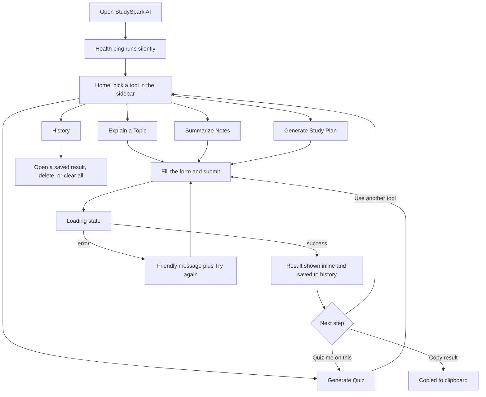
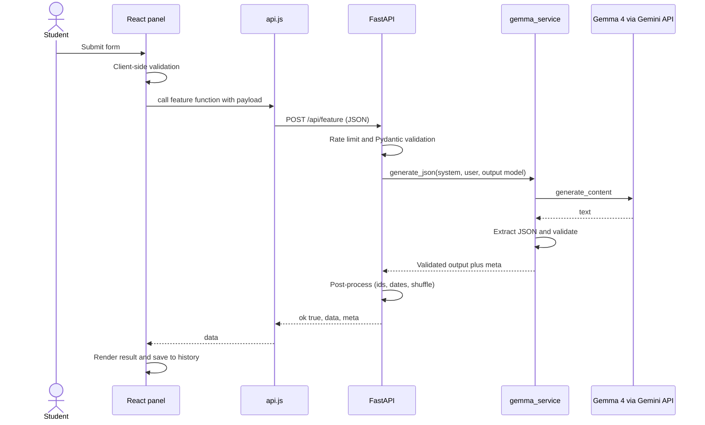
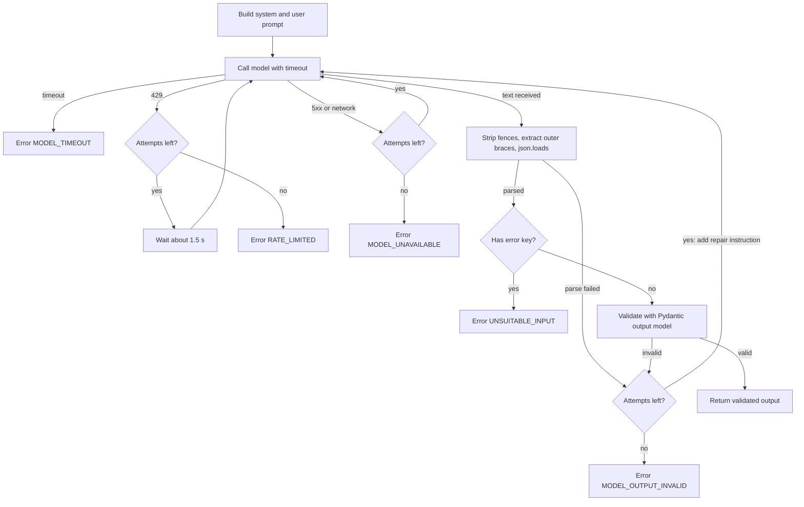
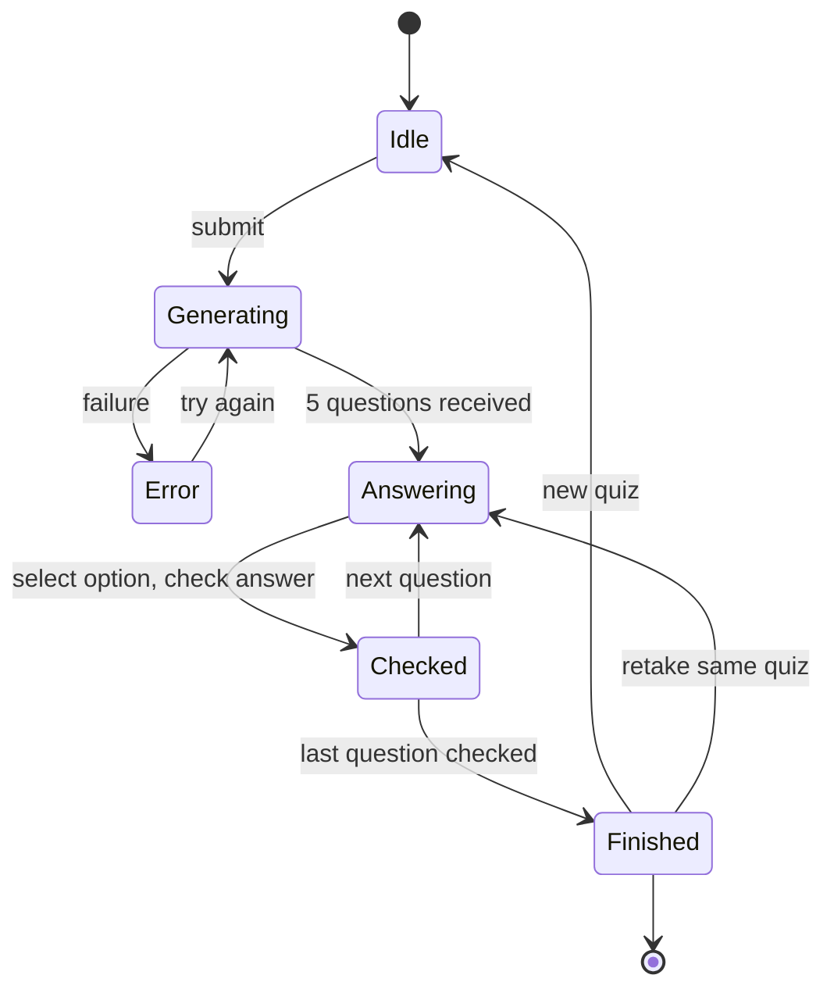
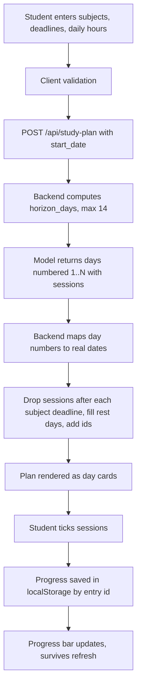
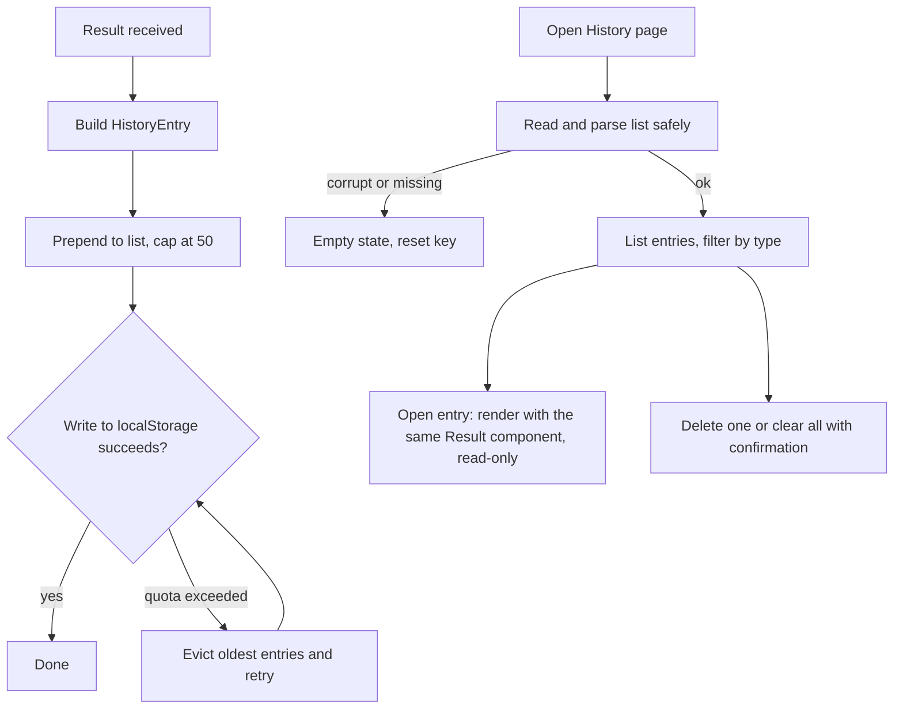
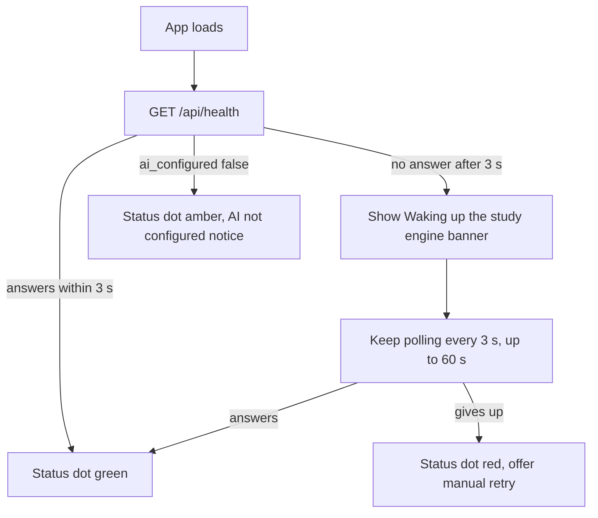
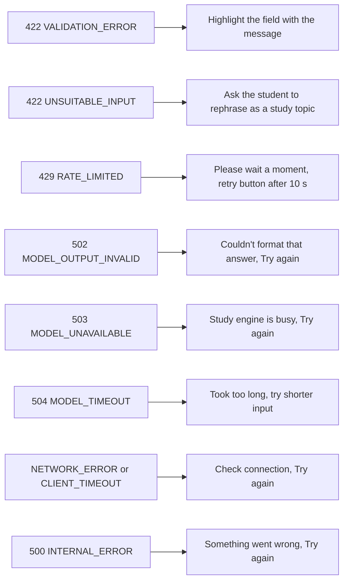

# User Flows and System Flows — StudySpark AI

---

## 1. Overall user journey

## 2. Request lifecycle (all AI features)

## 3. Model call with parse, repair and retry

Maximum 2 attempts in total across all retry reasons.

## 4. Quiz interaction state machine

On `Finished`: show score, per-question review with explanations, and save the score (E4).

## 5. Study plan: generation and progress

## 6. History and storage flow

## 7. Cold start and health

## 8. Error handling map

